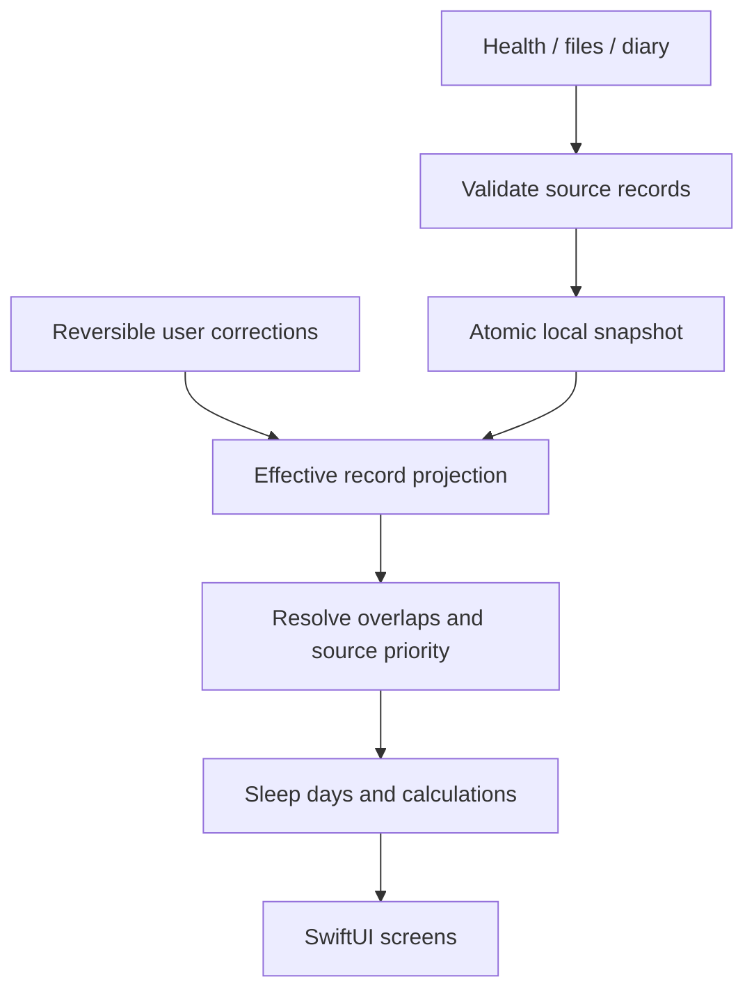

# Architecture

Luma is a native SwiftUI app with a small, independent Swift package for data and calculations. The app targets iOS 17. Apple-framework adapters sit outside the core. No server or third-party runtime dependency is required.

## Folder responsibilities

`App/LumaSleepApp.swift` owns scene lifecycle and the five tabs. `AppStore.swift` is the single main-actor writer and dependency composition root. `App/Features` contains Today, Tracking/editor, History/revisions, Insights, Planning, Settings, import/export, permission and recovery views. `App/Design` owns color tokens, layout containers, buttons and chart components. `App/Integrations` wraps HealthKit, Core Motion, AVAudioEngine, notifications, AlarmKit and App Intents.

`Core/Sources/LumaCore` contains canonical models, diary revisions, interval reconciliation, sleep-day calendars, insights, planning, CSV/JSON, demos and persistence. It imports Foundation only. The iOS project compiles these same files into its app module. `Core/Package.swift` compiles them into `LumaCore` for independent tests; this avoids an external package resolver dependency in Xcode. Do not add `import LumaCore` to app files without first changing that arrangement.

`Widget` is a separate extension. `Config` separates permissions and entitlements from source. `Scripts/generate_project.py` deterministically enumerates all app/core Swift files, creates two app schemes and the widget/test targets. Physical folders are the modular organization even though the generated Xcode Sources group is intentionally flat.

## Data flow

The adapter returns records plus a cursor; `AppStore` writes records, deletions and the new Health anchor **in one snapshot transaction**. Failed persistence must not advance the cursor. Source originals remain in `records`; Health deletions are tombstones in `deletedSourceIDs`. Diary revisions are append-only versions selected by `activeVersionID`. Corrections remove listed IDs from the projection and append replacements; undo only changes a flag. A deleted Health original does not erase a separately authored local correction.

`SleepReconciler` clips to a reporting window, unions bed evidence separately, and sweeps all non-bed interval boundaries. Every interval has at most one winning stage. Correction records win first, then configured source rank, a stable fallback source ID, stage specificity with awake first, and record ID. Lower-priority data fills gaps. No gap is interpolated as asleep. Efficiency requires the union of bed intervals to cover all counted sleep.

Sleep days end at a configurable hour in a fixed reporting IANA timezone. Calendar date arithmetic defines day boundaries, so a daylight-saving day can be 23 or 25 hours. Duration always uses absolute Date instants. Crossing a boundary apportions elapsed time; it never duplicates a whole night. Naps count only for their resolved intervals. Unknown nights remain nil, not zero.

## Interfaces and isolation

- `SnapshotStore`: synchronous load/save; production implementation is `JSONSnapshotStore`. Called only from the app's main actor. Tests inject a temporary location.
- `LumaClock`: `now`; a fake can be injected into `AppStore` for deterministic app-level behavior.
- `SleepImportSource`: availability, explanation, permission request and incremental `sync(anchor:)`. `HealthImporter` conforms; `AppStore` accepts an injected source.
- `ReminderScheduling`: notification installation and cancellation. Keep new reminder adapters behind it. The current app composes the concrete native service to expose the separate habit reminder helper.
- Calculations accept values and an explicit Calendar/preferences rather than reading UI state.
- The microphone processor is a deliberately isolated `@unchecked Sendable` object: its mutable fields and file writer are protected by one lock. Audio callbacks compute level statistics; only summary batches are dispatched to the main actor. Do not add UI, network calls or arbitrary unbounded work inside the tap.

The project uses Swift 5 language mode with concurrency checking, supported by modern Swift compilers. The core has no UIKit, HealthKit or microphone dependencies. UI and Apple SDK type checking must be done in Xcode; passing Linux tests does not validate those frameworks.

## Navigation and feature registration

The five tabs are explicit in `RootView`. Add feature screens as focused files in `App/Features`, link from the appropriate tab, and reuse shared components. The design does not use a dynamic plugin registry: a sixth tab requires an intentional product decision. `lumasleep://today` and `lumasleep://track` route widget links. Shortcuts open the app and call the same store transaction paths as UI controls.

## Permissions and capabilities

Request access when the user activates a feature, never during first launch. Basic compilation excludes HealthKit code through `HEALTH_ENABLED`; unavailable controls explain how to enable it. Health reads are privacy ambiguous: authorization completion means the prompt finished, not that reads were granted. The sync UI never infers refusal from an empty query.

AlarmKit is guarded both with `canImport(AlarmKit)` and an iOS 26 runtime check. It uses a fixed, alert-only alarm, avoiding a countdown Live Activity dependency. The widget is a separate target embedded only in Health. Motion history is not a background accelerometer entitlement. Audio's background mode exists only for explicitly started recording, never as a generic execution workaround.

## Persistence and migrations

Schema version 2 is a complete JSON snapshot. The codec supports the documented v1 envelope by adding missing arrays/default preferences before validation. Unknown future versions fail without overwriting the file. Apply every migration to a decoded copy; only validated output may be atomically committed. Never silently reset on a decoding error: `RecoveryView` exposes the original file and restore route.

Dates in backups are UTC ISO 8601 strings at whole-second precision. Log imports accept fractional seconds and explicit offsets; calculations use absolute instants. This first storage format is not for subsecond physiological signals. Source timezone identifiers are retained where supplied. Changing reporting timezone regroups history without changing original instants.

The iOS directory uses Data Protection allowing access after first unlock, required for authorized locked-screen audio summaries. It is excluded from automatic backup. User exports are explicit, unencrypted copies. Backups omit the device-specific Health anchor and raw audio files. Restore validates first, saves a pre-restore snapshot, stops recording, replaces data, disables notifications/widget sharing and discards retained audio. It does not implicitly reschedule or replace an independent fixed wake alarm. A corrupt store is never used as an empty replacement.

Storage is a single snapshot, not a database: personal-scale writes are simple and auditable, but writes run on the main actor. Imports are bounded to 10 MB / 20,000 rows; snapshots to 50 MB / 200,000 raw records. If performance requires background writing, introduce an actor repository and explicit commit ordering; do not scatter file writes across views.

## Privacy and demo boundary

Real data lives in the application container. Demo data is a separate in-memory snapshot selected by `AppStore.data`. Transactions update either demo memory or the real store, never both. External imports and sensor/scheduling actions are blocked in demo mode. The widget reads only opt-in planning preferences from the App Group. Never place health records or raw audio in UserDefaults or diagnostic logs. No health data or audio is sent to an AI service.

## Design system

Use semantic SwiftUI font styles, `LumaPage`, `Surface`, `SectionTitle`, `PrimaryButton` and dynamic `Luma` colors. `ViewThatFits` adapts the Today hero. Primary controls have minimum practical touch sizes; source labels and unknown-state text carry meaning independently of color. System controls and charts provide accessibility semantics; custom decorative icon/ring elements are hidden from VoiceOver. Root transactions disable animations under Reduce Motion. These choices are implemented in source, not certified by a device accessibility audit.

## Tests and extension policy

Core XCTest coverage is in `Core/Tests/LumaCoreTests`. Add a regression at the data boundary when a new rule changes provenance, calendar arithmetic, persistence or deduplication. Native smoke tests are in `Tests/LumaUITests.swift` and use a separate temporary store. Do not point tests at real Health or user history. Regenerate the Xcode project after adding files, run core tests, build both app schemes and execute the relevant device checklist.

Important tradeoffs: no biological debt score; no validated alertness claims; no stage inference from motion/audio; no fake source permission state; no guaranteed background refresh; no widget history disclosure; and no hidden cloud dependencies.
